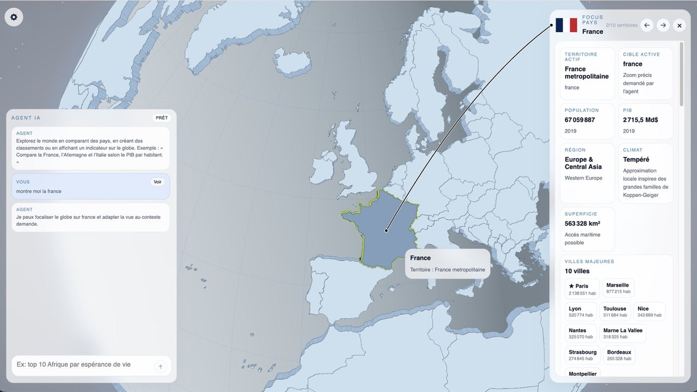
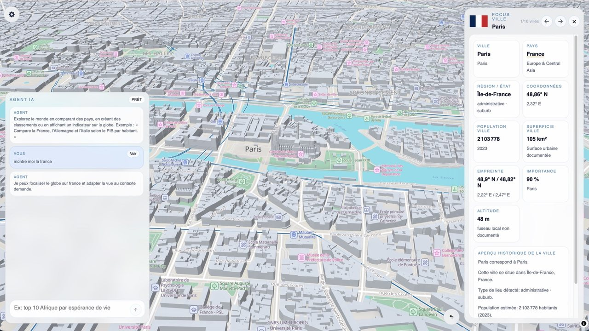
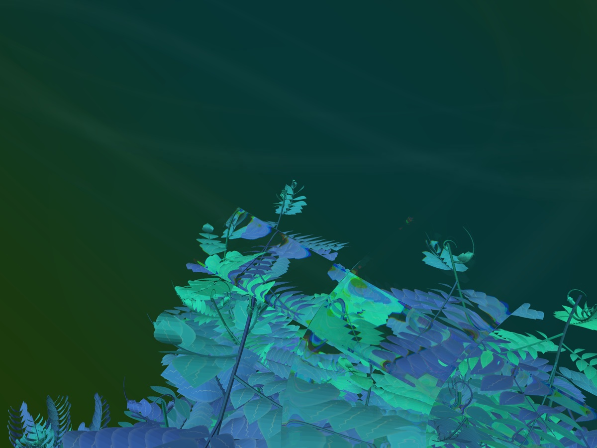
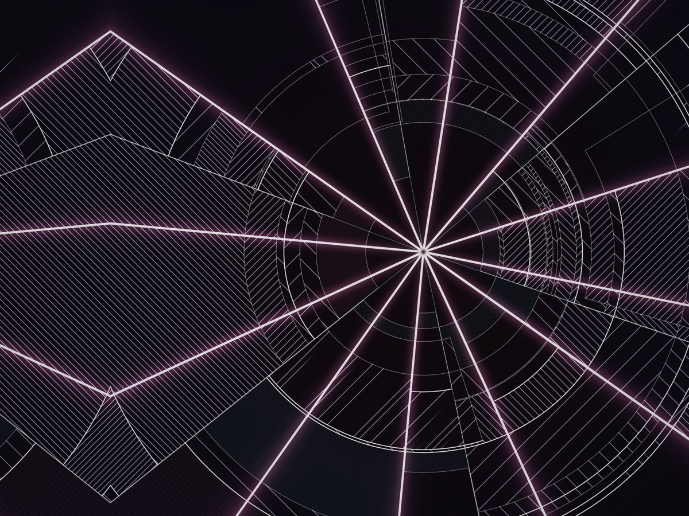
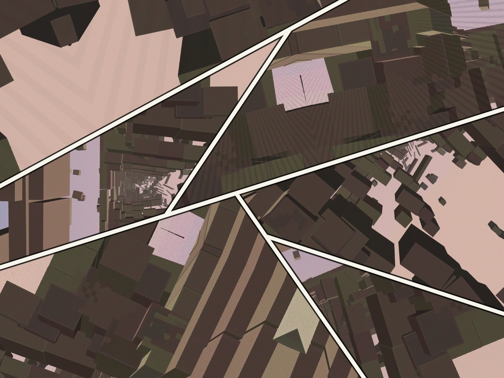
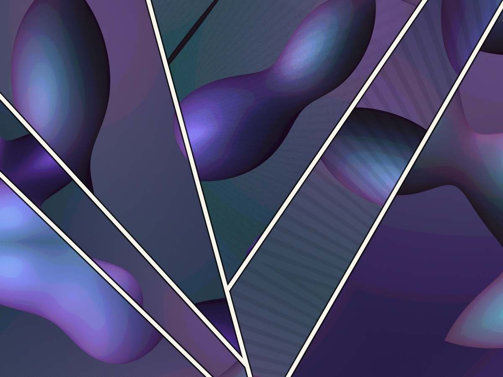

# Manuel Reismann

### Creative Developer & Senior Front-End Engineer

I build interactive web experiences at the intersection of **code, data, graphics and sound**.

My background combines front-end engineering with creative development — from complex React applications to real-time data visualization, WebGL experiences and audio-reactive interfaces.

---

### What I work with

**Front-end**  
React · TypeScript · JavaScript · Next.js

**Creative & Data**  
Three.js · WebGL · GLSL · Data Visualization · Real-time Graphics

**Beyond the browser**  
Node.js · REST APIs · Capacitor · PostgreSQL

**Currently exploring**  
Generative AI · WebGPU · Creative Coding

---

## Selected work

### 🌍 PlanetLive

  
  

**AI-assisted interactive 3D globe for geographic, historical & geopolitical data exploration and country comparison.**

Explore countries and world data through interactive cartography, visual comparisons and AI-assisted queries.

→ [**Explore PlanetLive**](https://www.planet-live.fr)

---

### 🎵 AudioGrafik 2.0

  
  

  
  

**Real-time music visualizer for web, iPhone and iPad, built with WebGPU, WebGL2 and native UIKit controls on iOS.**

20 generative scenes and 20 combinable effects respond to percussion, melody and musical tension. Choose your visuals in the VJ workspace, or record them with sound from an imported audio file or microphone input.

→ [**Explore AudioGrafik**](https://www.audiografik.net/)

---

### 🎸 RhythmTrainer

**Interactive rhythm training application.**

A music-focused application for practicing rhythm through interactive exercises.

---

### About me

I'm particularly interested in projects where engineering meets **visualization, interaction, music, culture and creative technology**.

🌐 [**Portfolio — m4nu.net**](https://www.m4nu.net)  
💼 [**LinkedIn**](https://www.linkedin.com/in/manuel-reismann-6446324)
